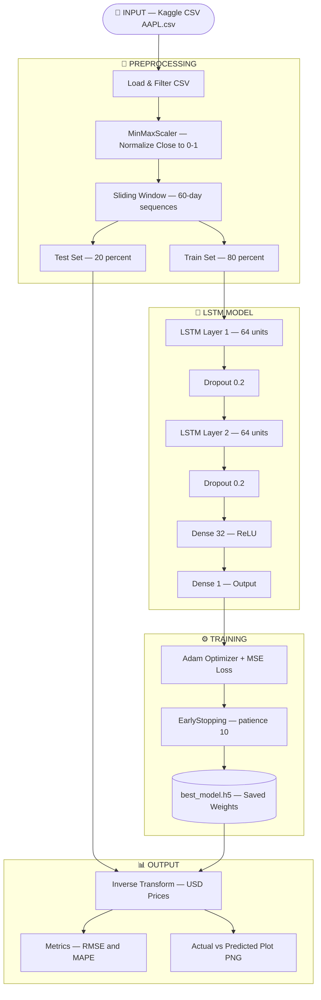

## Block Descriptions

| Block | Components | Purpose |
|---|---|---|
| 🔧 Preprocessing | CSV Load, MinMaxScaler, Sliding Window, Split | Prepare raw data into LSTM-ready sequences |
| 🧠 LSTM Model | LSTM×2, Dropout×2, Dense(32), Dense(1) | Learn temporal price patterns |
| ⚙️ Training | Adam, MSE Loss, EarlyStopping, ModelCheckpoint | Optimize and save best weights |
| 📊 Output | Inverse Transform, RMSE, MAPE, Plot | Evaluate and visualize predictions |